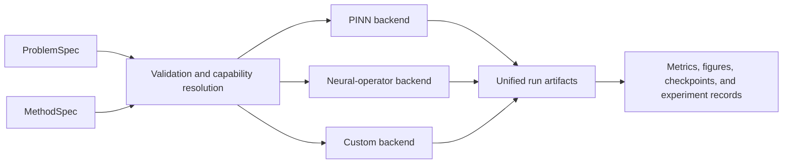

# OpenPINN/PINO

[](https://arxiv.org/abs/2611.23135)
[](LICENSE)

**Preprint:** [OpenPINN/PINO: An Extensible Open-Source Framework for Agent-Assisted Physics-Informed Neural Networks and Neural Operators](https://arxiv.org/abs/2611.23135)

OpenPINN/PINO is an extensible PyTorch framework for physics-informed neural networks (PINNs), physics-informed neural operators, and agent-assisted scientific machine learning. It connects physical problem definition, numerical method configuration, local training, evaluation, and reproducible experiment records through shared machine-readable specifications.

The framework represents a physical problem with `ProblemSpec` and a numerical recipe with `MethodSpec`. The method specification separates five configurable axes—model, sampling, loss, optimization, and differentiation—so researchers can compare or compose numerical strategies without duplicating complete training programs.

OpenPINN/PINO supports pointwise PINN models and operator backbones such as DeepONet and FNO. Coordinate automatic differentiation, finite-difference operators, and spectral differentiation are selected through explicit capability checks. An optional five-stage agent workflow helps users understand a problem, plan a solver, validate the specifications, generate local code, and diagnose run artifacts.

## Highlights

- **PINNs and neural operators:** single-instance field solvers, DeepONet, FNO, and physics-informed operator training.
- **Shared specifications:** `ProblemSpec` describes geometry, physics, conditions, and data; `MethodSpec` records the five numerical method axes.
- **Composable methods:** Fourier features, adaptive sampling, adaptive loss weighting, hard constraints, modified MLPs, domain decomposition, staged optimization, and transfer learning.
- **Multiple differentiation paths:** coordinate autodiff for pointwise and query-coordinate models, plus finite-difference and spectral derivatives for structured-grid models.
- **Agent-assisted workflow:** problem understanding, solver planning, specification validation, deterministic code building, and diagnostic evaluation.
- **Auditable local computation:** training remains in the user's Python environment and produces configurations, histories, checkpoints, metrics, predictions, and figures.
- **Extension interfaces:** register new models, samplers, losses, optimizers, differentiation paths, problems, or custom execution backends.

## Architecture



PINN and operator models share the specification and component surfaces, while retaining the tensor layouts and training runners appropriate to each model family. Invalid model–backend–differentiation combinations are rejected before training.

## Installation

OpenPINN/PINO requires Python 3.10 or newer. PyTorch and the core scientific dependencies are installed from `pyproject.toml`.

```bash
git clone https://github.com/junelu0214/OpenPINN-PINO.git
cd OpenPINN-PINO
python -m venv .venv
source .venv/bin/activate
python -m pip install --upgrade pip
python -m pip install -e .
```

For tests and documentation:

```bash
python -m pip install -e ".[test,docs]"
```

## Quick start

### Solve a PDE with a PINN

```python
import openpinn as op

result = op.solve(
    "poisson",
    method="baseline",
    steps=1000,
)

print(result.metrics)
print(result.output_dir)
```

Methods can be composed when they control independent component slots:

```python
result = op.solve(
    "poisson",
    methods=[
        op.method("fourier"),
        op.method("adaptive_weights", "relobralo"),
    ],
    steps=1000,
)
```

### Train a neural operator

```python
import openpinn as op

result = op.train_operator(
    "fno",
    training_mode="physics_only",
    steps=1000,
)

print(result.final_loss)
```

DeepONet uses coordinate derivatives at query locations. FNO uses derivatives on structured output grids. Operator training supports `data_only`, `physics_only`, and `hybrid` objectives.

## Shared problem and method specifications

The paper-aligned method vocabulary uses `backend`, `model`, `sampling`, `loss`, `optimization`, and `differentiation`. Earlier field names remain readable for compatibility.

```yaml
problem:
  geometry:
    type: interval
    bounds: [0.0, 1.0]
  physics:
    family: poisson
  conditions:
    - type: dirichlet
      region: boundary
      value: 0.0
  data: null

method:
  backend: operator
  model:
    name: fno
    options:
      modes: 16
      width: 32
  sampling:
    name: structured_grid
  loss:
    formulation: strong
  optimization:
    name: adam
    lr: 0.001
  differentiation:
    name: spectral
  training:
    mode: physics_only
    steps: 5000
```

`CapabilityRegistry` resolves the selected model, backend, training mode, and differentiation path into an explicit execution plan. Backend-specific results can be exposed through the common `UnifiedRunResult` view for postprocessing and diagnostics.

## Agent-assisted workflow

```text
Problem Understanding
        ↓
Solver Planning
        ↓
Specification Validation
        ↓
Code Building
        ↓
Local Training and Diagnostic Evaluation
```

The agents operate on the same structured specifications used by the Python API and configurator. Generated code is intended to be inspected and executed locally; the browser documentation does not run training jobs.

OpenPINN/PINO also provides a lightweight workflow harness for use with general-purpose coding agents:

```bash
openpinn harness init openpinn_tasks/my_problem
openpinn harness check openpinn_tasks/my_problem
openpinn harness run openpinn_tasks/my_problem
openpinn harness inspect openpinn_tasks/my_problem
```

See [`docs/agent_harness.rst`](docs/agent_harness.rst) for the evidence and execution contracts.

## Examples

| Example | Purpose |
|---|---|
| [`examples/poisson.py`](examples/poisson.py) | Baseline one-dimensional Poisson PINN |
| [`examples/burgers.py`](examples/burgers.py) | Time-dependent Burgers PINN |
| [`examples/reproduce_methods.py`](examples/reproduce_methods.py) | Controlled method comparisons |
| [`examples/plate_with_hole.py`](examples/plate_with_hole.py) | Two-dimensional elasticity and specification workflow |
| [`examples/inverse_seepage_consolidation.py`](examples/inverse_seepage_consolidation.py) | Inverse seepage and consolidation workflows |
| [`examples/tutorials/`](examples/tutorials/) | PINN, DeepONet, FNO, hybrid, and extension notebooks |

The documentation contains focused reproductions of the Burgers method comparison, periodic Poisson operator study, and plate-with-hole agent workflow.

## Documentation and configurator

Build the bilingual Sphinx documentation and browser configurator locally:

```bash
python scripts/build_docs.py
```

Then open `docs/_build/html/index.html`. The Chinese documentation is the default tree, and the English tree is generated under `docs/_build/html/en/`.

Offline user and developer manuals are available in [`docs/manuals/public/`](docs/manuals/public/). More detailed installation, modeling, operator, validation, reproducibility, and extension guidance lives in [`docs/`](docs/).

## Repository layout

| Path | Role |
|---|---|
| `src/openpinn/` | Core library, component registries, execution backends, agents, and artifacts |
| `configs/` | Problem, method, training, experiment, and reference-run configurations |
| `examples/` | Runnable examples, tutorials, geometries, specifications, and reference data |
| `user_projects/` | Templates for project-specific equations and workflows |
| `docs/` | Sphinx documentation, manuals, configurator, and method catalogue |
| `tests/` | Unit, contract, smoke, regression, and browser-DOM tests |
| `scripts/` | Documentation, validation, and maintenance entry points |

## Development

```bash
python -m pytest -q
python scripts/build_docs.py
npm ci --ignore-scripts --no-audit --no-fund
npm test
```

New numerical methods should extend the relevant component interface, register their capability and defaults, add focused tests, and document the comparison protocol. See the developer guide and method ecosystem documentation for the contribution path.

## Project status

OpenPINN/PINO is research software. The current scope emphasizes smooth tutorial PDEs, registered PINN methods, DeepONet and FNO workflows, structured-grid operator physics, deterministic specification validation, and local reproducibility artifacts. Complex contact, strong geometric nonlinearity, and general three-dimensional unstructured neural operators remain outside the current validated scope.

## Citation

If OpenPINN/PINO contributes to your research, please cite the preprint:

```bibtex
@article{wang2026openpinn,
  title   = {OpenPINN/PINO: An Extensible Open-Source Framework for Agent-Assisted Physics-Informed Neural Networks and Neural Operators},
  author  = {Wang, Xi and Lu, Jun and Zhang, Cheng and Zhuang, Xiaoying and Rabczuk, Timon and Zhu, Hehua and Wu, Wei and Li, Peinan and Zhao, Jidong and Yin, Zhen-Yu and Sun, Hao},
  journal = {arXiv preprint arXiv:2611.23135},
  year    = {2026},
  url     = {https://arxiv.org/abs/2611.23135}
}
```

GitHub's **Cite this repository** menu uses [`CITATION.cff`](CITATION.cff), which contains the same preferred citation.

## License

OpenPINN/PINO is released under the [Apache License 2.0](LICENSE). Third-party components and bundled assets are documented in [`THIRD_PARTY_NOTICES.md`](THIRD_PARTY_NOTICES.md) and [`LICENSE_STATUS.md`](LICENSE_STATUS.md).
