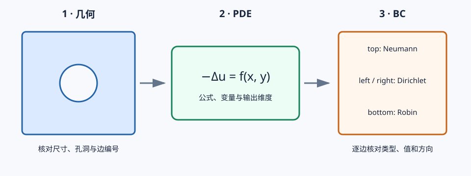
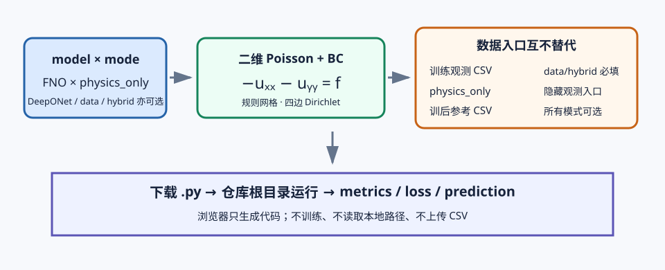

五 Agent 工作台教程
======================

这页用同一个 :doc:`method_configurator` 走完问题理解、求解规划、规范验证、代码构建和
诊断评估。工作台在浏览器中设计问题并生成 Python；它不会训练、不会读取所填路径的文件，也不会上传 CSV。
下载 ``.py`` 后，训练和产物写入都发生在本地 Python 环境。

开始前
------

#. 按 :doc:`install` 在仓库根目录安装 ``python -m pip install -e ".[test,docs]"``。
#. 打开 :doc:`method_configurator`。可从自然语言交给问题理解 Agent，也可直接编辑问题与方法规范。
#. 页面预览用于核对几何、PDE 和边界语义；最终以下载脚本中的对象和参数为准。

单问题场求解：几何 → PDE → 边界 → 方法
--------------------------------------

#. 在模型模块选择 MLP、KAN、GNO 等点式场模型。选一维区间或二维几何；二维可使用矩形、圆孔、图片/DXF
   识别后的轮廓等已有入口。
#. 在控制方程设计器选择模板或自由组合项，核对 PDE 公式和变量维度。
#. 逐侧设置 Dirichlet、Neumann 或 Robin 条件；预览中的边名、方向和数值应与表单一致。
#. 选择方法、训练步数、采样数和网络参数。短步数只适合链路检查。
#. 点击“下载 .py”，在仓库根目录执行 ``python 下载的文件.py``。

   PINN 路径示意：先核对几何与边编号，再核对 PDE，最后检查逐边条件。

脚本运行后会打印结果目录。常见产物包括 ``metrics.json``、``history.csv``、
``predictions.npz``、``loss.svg`` 和 ``result.svg``；具体解释见
:doc:`user_guide_results`。完整的瞬态与二维 Poisson 案例见 :doc:`code_tutorials`
中的 Burgers 与 PINN 2D Poisson notebooks。

参数族求解：问题 → 算子模型 → 训练目标
--------------------------------------

#. 先定义要学习的参数化物理问题，再选 DeepONet 或 FNO，以及 ``data_only``、
   ``physics_only`` 或 ``hybrid``。不要把已弃用的 PINO shim 当作第三个模型。
#. 使用同页问题设计器定义自定义一维/二维 PDE 与边界。DeepONet 走坐标自动微分，
   FNO 在规则网格上使用网格导数。
#. 根据模式配置数据：

   * **训练观测 CSV** 只为优化提供监督项。``data_only`` 与 ``hybrid`` 必填；
     ``physics_only`` 隐藏该入口，也不会静默借用参考数据。
   * **训后参考 CSV** 只用于训练后的指标比较，三种模式都可选。
   * 两套开关、路径、列映射和尺度完全独立。页面只把本地路径写入脚本，绝不上传文件。

#. 下载 ``.py`` 并在仓库根目录运行。非法的模型、模式、PDE 或数据组合会在复制/下载前
   明确报错，不会换成另一条路径。

   Operator 路径示意：模型与模式决定训练目标，PDE/BC 定义物理，观测与参考数据不混用。

与代码教程对应
--------------

:doc:`code_tutorials` 的主算子案例使用 **FNO × physics_only** 训练二维 Poisson，因此
不提供观测 CSV；notebook 中的解析解仅做预测对照。若切换到 ``hybrid``，必须另行提供
训练观测，参考 CSV 仍保持可选。配置器仍是下载独立 ``.py`` 的入口，notebook 则适合
逐单元查看物理设置、损失和预测图。
